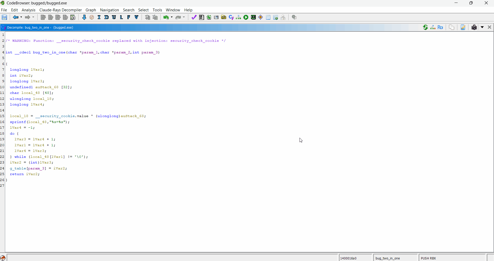
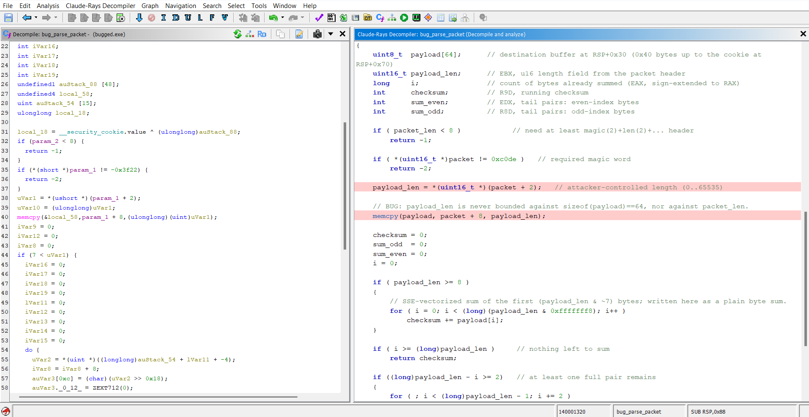
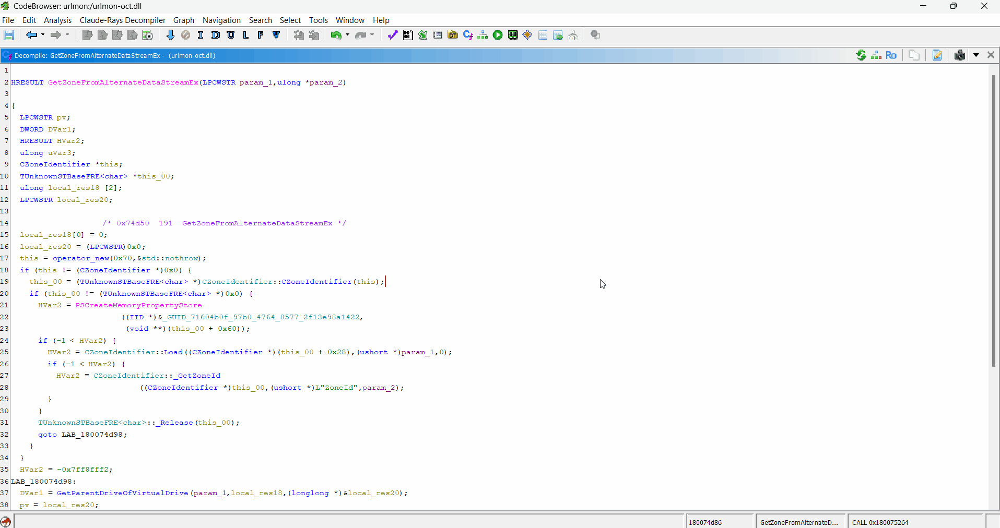
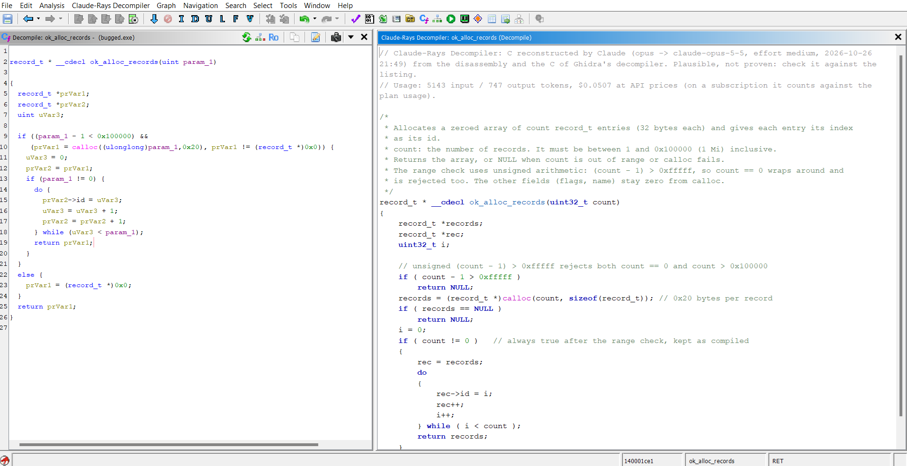
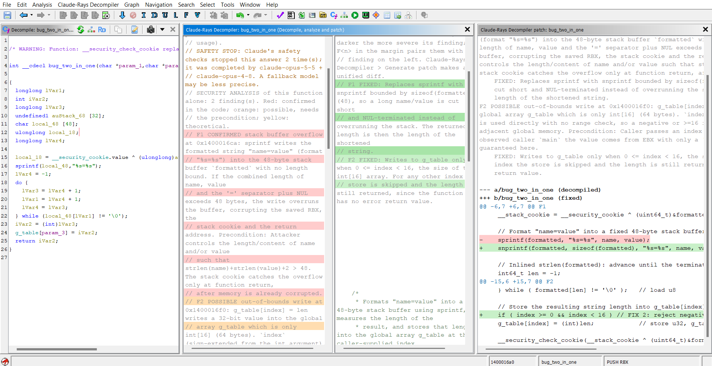

# Claude-Rays Decompiler for Ghidra

**Decompile, analyze and patch a function with Claude, from the disassembly and Ghidra's own decompiler.** A Ghidra extension that gives Claude both views of a function, the annotated listing and the C of Ghidra's decompiler, and returns readable C, a security review and suggested fixes.



> **Note:** So far the extension has only been tested on Windows, with Ghidra 12.1.4. The GUI was tested on x86/x64 binaries; the instruction facts of the other processors were checked headless on small ARM, AArch64, MIPS, RISC-V and PowerPC functions.

It is the sibling of [Claude-Rays Decompiler for IDA Free/Pro](https://github.com/Claude-Rays/claude-rays-decompiler-idafree), with the same validation, cache, security review and fixes. The difference is the input: in IDA Free there is no decompiler a plugin can use, so the IDA plugin works from the disassembly alone; in Ghidra the decompiler is always there, so this extension also gives Claude its C. It is also the engine behind *Claude diff pseudo-code* in [Diaphora-ng for Ghidra](https://github.com/Claude-Rays/diaphora-ng-ghidra).

## Motivation

The idea came while designing an IDA Free version of [aidapal](https://github.com/atredispartners/aidapal), the plugin by Atredis Partners that sends the decompiled code of a function to a local model trained for the task and gets back a name, a comment and variable names. That was two years ago, with a model trained for one job. Why not use what Claude can do today instead, and go one step further: let it write the C itself? In Ghidra, it gets both the disassembly and the C of Ghidra's own decompiler to work from.

It is also the opposite of the MCP servers for disassemblers, such as [ida-free-mcp](https://github.com/0xshlomil/ida-free-mcp). Those connect the disassembler to Claude: Claude drives it through tools and decides what to look at. Claude-Rays Decompiler connects Claude to the disassembler: the extension collects the context of one function deterministically, asks Claude for one thing (decompile, analyze or patch it), validates the answer against the program and shows it in a Ghidra view, next to Ghidra's decompiler.

### What you give up

- **The reverser's own work.** In Ghidra, understanding a function usually means renaming functions, variables and structures, retyping and commenting in the decompiler until the code reads well, and Ghidra keeps all of it. Here Claude does that step in one go: you get higher-level code, with the names, types and structures the model chose, instead of building them yourself.
- **The view is read-only.** You cannot rename or retype in it. You can still follow the code: a double-click on a callee opens its own view, Shift+double-click and a double-click on a line jump to the listing. What you rename or retype in the program is part of the context of the next query (also through Ghidra's C); a cached result whose callees were renamed is marked `STALE`, and *Regenerate* picks up the new names. The only thing the extension writes back is the summary, as the function comment, when you ask for it.

### Not an act of faith

- The output is **plausible, not proven**. Claude reconstructs the C from the listing and Ghidra's draft; the validator checks calls, basic blocks and addresses against the program, not the semantics. Treat the code as a strong hypothesis to confirm in the listing, especially on hostile binaries, which can also try to mislead the model.
- The **security review** sees one function: bugs that depend on the callers mostly stay out of reach, and a result with no findings does not mean the function is safe.
- The **fixes** are a patch of the decompiled C, a suggestion to read, not a patch of the binary.
- The disassembly, Ghidra's C and the names in the program **leave your machine** (see [Privacy and cost](#privacy-and-cost)).

## What it does

- **Decompile from both views.** The extension collects the function's context from the program: the listing annotated by basic block with exact instruction facts, the stack frame, callees, call sites, data and types, and **the C of Ghidra's decompiler as a draft**, each line tagged with the address of its first instruction. Claude, through the [Claude Code](https://claude.com/claude-code) CLI, takes the structure and data flow from the draft and the facts from the listing, which wins when they disagree, and writes C without Ghidra's artifacts (`unaff_`, `CONCAT`, `uVar3`...). The answer opens in a colored, navigable view, next to Ghidra's decompiler. See [Context modes](#context-modes) for the other two inputs (listing only, or the draft first).
- **Validate.** The model tags every statement with the address of its first instruction (`/*0x401020*/`). The extension checks those addresses against the program: missing calls, basic blocks without code and addresses outside the function become warnings in the header of the view. The same addresses let you jump from any line to the listing. The view hides them by default.
- **Decompile and analyze.** The same query also asks for a security review: each finding has a level (*confirmed*, *possible*, *theoretical*), a class, the instructions of the bug and the precondition it needs. Findings are colored in the view and in the listing.
- **Decompile, analyze and patch.** A second query asks for the fixes of the confirmed and possible findings. The view shows the original and the fixed code side by side, and *Generate patch* turns them into a unified diff.
- **Any processor Ghidra disassembles.** x86/x64 get exact instruction facts from the mnemonics; the other processors get the same kinds of facts computed from the p-code.
- **Cache.** Results are stored in the program, so each function is paid for once. Open views are reopened from the cache with the program.
- **Diff of two versions.** A Ghidra service lets [Diaphora-ng for Ghidra](https://github.com/Claude-Rays/diaphora-ng-ghidra) ask for both versions of a changed function, decompiled and aligned in one query, with the changes and a security assessment.

### On a test program

A small Windows x64 test program, built with MSVC `/O2`, has 15 functions with deliberately planted bugs (16 bugs: stack and heap overflows, off-by-one, integer overflow and truncation, use after free, double free, format string, signedness, null dereference, uninitialized memory, command injection) and 3 correct functions as controls. *Decompile, analyze and patch* on each of them, with the default model (Opus, effort `medium`) and the default context:

- **All 16 bugs were found with the right class**, and the 3 controls got **no finding**.
- **Levels** were mostly as expected. The model tends to say *confirmed* where the input comes from the caller (*possible* was expected).
- **Fixes** were minimal and to the point. The function whose risky `strcpy` is safe (theoretical only) correctly got no fix.
- Some functions got extra findings; most were theoretical or reasonable.
- The 18 functions cost about $2.14 at API prices ($1.77 to decompile and analyze, $0.36 for the fixes).
- 4 of the 22 queries came back without code because of Claude's safety checks (see [Safety stops](#safety-stops)); they worked when run again.



### A real binary

The three commands on `GetZoneFromAlternateDataStreamEx` of urlmon.dll (October 2026), next to Ghidra's decompiler, with the results taken from the cache. The review only finds theoretical issues, so there is nothing to fix and *Decompile, analyze and patch* shows the findings without a patch:



## Requirements

- Ghidra 12.1.4+ and the JDK it runs on (21+; tested with 25).
- [Claude Code](https://claude.com/claude-code), installed and logged in (run `claude`, then `/login`). Tested with CLI 2.1.301.
- A Claude subscription (Pro/Max) or pay-as-you-go API billing. No API key is stored by the extension: it runs the `claude` CLI, which uses your own login.

## Build & install

```bat
set GHIDRA_INSTALL_DIR=C:\path\to\ghidra_12.1.4_PUBLIC
gradlew.bat buildExtension
```

The Gradle wrapper downloads Gradle the first time. The extension zip lands in `dist\` (`ghidra_12.1.4_PUBLIC_<date>_clauderays-ghidra.zip`).

To install it: in the Ghidra project window, *File > Install Extensions*, **+**, pick the zip, and restart Ghidra. In the CodeBrowser, enable **ClaudeRaysPlugin** when Ghidra offers the new plugins, or in *File > Configure* (package *Claude-Rays Decompiler*). The console shows `Claude-Rays Decompiler for Ghidra <version> by ClaudeMonkey (...)` when it loads.

A prebuilt zip only installs on the Ghidra version it was built for; for another version, build it with that Ghidra.

## Usage

In the Listing or in Ghidra's decompiler: right-click > *Claude-Rays Decompiler > Decompile*, or **Ctrl+Shift+F5** (change it in *Edit > Tool Options > Key Bindings*). The main menu *Claude-Rays Decompiler* has the same commands for the function at the cursor.

The view *Claude-Rays Decompiler: &lt;function&gt;* opens at once and shows the status. While Claude works, a task dialog says which function is being decompiled and with which model; its **Cancel** kills the query. A query usually takes from a few seconds to a couple of minutes, depending on the size of the function, on whether it is also analyzed, and on Claude.

| Where | Actions |
|---|---|
| Listing / decompiler | `Decompile` (uses the cache), `Decompile and analyze` (Ctrl+Shift+F6), `Decompile, analyze and patch` (Ctrl+Shift+F7), `Clear security highlights`, `Other model/<model>` (ignores the cache), `Decompile with context/<mode>` (ignores the cache), `Show collected context` (prints to the console what would be sent, without sending anything), `Cancel`, `Settings` |
| Claude-Rays Decompiler view | `Regenerate` (runs the command of the view again), `Decompile`, `Decompile and analyze`, `Decompile, analyze and patch`, `Generate patch` (only in a view with fixes), `Clear security highlights`, `Regenerate with other model/<model>`, `Decompile with context/<mode>`, `Apply summary as function comment` (asks before replacing an existing comment; undoable), `Copy code` (in a patch view: the patch), `Cancel`, `Settings` |
| Main menu *Claude-Rays Decompiler* | `Decompile the current function`, `Decompile and analyze the current function`, `Decompile, analyze and patch the current function`, `Show collected context`, `Settings` |



**Navigation:**
- **Double-click on another function** (qualified or templated C++ names too) opens its view: from the cache, or with a new query.
- **To the listing:** thunks and imports go there, and so does any **Shift+double-click**.
- **Elsewhere:** a double-click on a data item jumps to it; anywhere else on a line, to that line's address, or to the address of the closest line above that has one.

**Persistence:** the cache is a string property map of the program per command (one JSON per function, saved with the program). The open views are remembered in the program's user data and reopened from the cache when the program is opened again; nothing is queried.

### Context modes

*Settings > Context*, or one function with *Decompile with context*:

| Mode | What is sent of the function |
|---|---|
| `listing` | The disassembly annotated with the instruction facts only, without Ghidra's C. |
| `listing + Ghidra's C` (default) | The same, plus the C of Ghidra's decompiler as a draft (data flow, merged variables, structure), each line with the address of its first instruction. The prompt tells the model that the listing wins when they disagree, and not to copy the artifacts (`unaff_`, `CONCAT`, ...). |
| `Ghidra's C + plain listing` | The draft first and the listing without facts or listings of small callees: smaller, faster, less faithful. |

Ghidra's C is left out when it is larger than the listing, when it does not fit in the context budget, or when Ghidra's decompiler fails: the result is then made from the listing alone, and the view header says why. The cached result remembers its mode, and the view header says which one.

### Decompile and analyze

*Decompile and analyze* asks, in the same query, for a security review of the function besides its C. It costs about 30% more output tokens than a plain decompilation. Each finding has a level, a class, the instruction addresses of the bug, a description and the precondition it needs outside the function. The levels are judged from the function alone:

| Level | Meaning | Color |
|---|---|---|
| `confirmed` | the bug is in the code whatever the callers do (unchecked copy into a fixed buffer, off-by-one with constant sizes, use after free in the function...) | soft red |
| `possible` | a bug only if a precondition the function does not check holds (the caller controls a length, an index...) | soft orange |
| `theoretical` | a risky pattern without evidence of a bug | yellow |

The addresses are validated like the annotations: an address that is not an instruction of the function is dropped (with a warning), and so is a finding left without addresses, so nothing is colored where the model only guessed. The findings go in the header of the view; their statements get the color of the most severe finding, with the finding as tooltip; and, when the result is new, their instructions are colored in the listing (*Clear security highlights* removes them). Bugs that depend on the callers (races, checks made elsewhere) are mostly out of reach of a function alone: no findings is not a clean bill.

### Decompile, analyze and patch

*Decompile, analyze and patch* does the same and then asks, in a second query, for the fixes of the confirmed and possible findings (a theoretical one has no bug to fix). That query gets only the decompiled C with numbered lines and the findings, and the model answers with edits of those lines, one fix per finding; the fixed code, the view and the patch are built by the extension from the edits. An edit outside the code, one that overlaps another edit or a fix of a finding that was not asked for is dropped with a warning. A finding that needs something the function does not have (the size of a caller's buffer, a lock taken elsewhere) is answered as *not fixable*, with what and where to fix.

With at least one fix, the view shows the function **side by side**: the decompiled code on the left with the colors of the analysis, the fixed code on the right, aligned row by row and scrolling together. The lines of each fix are **green, darker the more severe its finding**, and both sides have the number of the finding (`F1`, `F2`...) in the margin, also on the lines of the findings themselves. The right header says what became of each finding: fixed, no edits (covered by another fix, or nothing to change), not fixable here, or not fixed (theoretical).

**Generate patch** (nothing is queried) opens *Claude-Rays Decompiler patch: &lt;function&gt;* with the fixes as a unified diff of the code as the view shows it: a header with each finding and its fix, then the hunks, each named after its findings (`@@ -10,7 +10,9 @@ F1`). *Copy code* copies it. It is a patch of the decompiled C, not of the binary: a suggestion to read, not something to apply.



### Safety stops

The security review of a function that looks like an exploit target can trip Claude's safety checks. The CLI reports them as `safety_stops`. After a stop, the CLI often finishes the answer with another model, and the view header then says so in a `SAFETY STOP:` line with the models that took part. Sometimes the answer comes back empty, and the model says that it cannot produce it; the extension then shows that, with the model's own words, instead of a generic error. Nothing is retried automatically, and the prompts are not reworded to get past the checks. *Regenerate* asks again in a new query; *Decompile* without the analysis is another option. The same holds for the fix query and for the diff of two versions.

### Reusing results between the three commands

Each command (*Decompile*, *Decompile and analyze*, *Decompile, analyze and patch*) has its own view of the function (its title and tab say which: `main [analyze]`) and its own cached result. The three build on each other, and the cache uses that to avoid paying twice:

| You have cached | You ask for | What happens |
|---|---|---|
| Decompile, analyze and patch | Decompile and analyze | Taken from it without the fixes. Nothing is queried. |
| Decompile, analyze and patch | Decompile | Taken from it without the analysis. Nothing is queried. |
| Decompile and analyze | Decompile | Taken from it without the analysis. Nothing is queried. |
| Decompile and analyze | Decompile, analyze and patch | Only the fixes are queried (the second query). |
| Decompile | Decompile and analyze, or ... and patch | A full new query: the analysis needs the model to read the function again. |

So the cheapest order is to run the most complete command you will need first, and take the others from it. A result taken from another command is not saved, and the view header says where it comes from; *Regenerate* in that view makes a result of its own.

### The view header

```c
// Claude-Rays Decompiler: C reconstructed by Claude (opus -> claude-opus-5-5, effort medium, 2026-10-19 23:05) from the disassembly and the C of Ghidra's decompiler. ...
// Usage: 6903 input / 2242 output tokens, $0.1001 at API prices (on a subscription it counts against the plan usage).
// Context asked by the model: 1 extra round(s).
// WARNING: ...      validator warnings
// UNCERTAIN 0x...:  doubts declared by the model itself
// STALE: ...        the names of the called functions changed since the result was generated
```

## Settings

Kept in Ghidra's user preferences (keys `clauderays.*`):

- **Claude path:** `claude` by default, looked up in `PATH` and in `%USERPROFILE%\.local\bin`.
- **Default model:** **opus** (effort `medium`), from the catalog in `core/Models.java`; *Extra models* takes IDs that are not in it. The `Other model` menus offer both.
- **Effort:** `auto` uses the catalog default of each model (never below `medium`), or a forced level from `low` to `max`.
- **Context:** the [context mode](#context-modes).
- **Timeout** per answer (300 s), **max instructions** (1500), **context budget** (60000 characters).
- **Verbose:** full input and output, section sizes, token usage and `need_more` rounds in the console.
- **Show address annotations** in the view (off by default).

Why Opus `medium` is the default is explained in [Choosing a model](https://github.com/Claude-Rays/claude-rays-decompiler-idafree#choosing-a-model).

## How it works

| File | Role |
|---|---|
| `program/Collector.java` | Context: header, stack frame (with register arguments), listing annotated by basic block (successors, kind, loops from dominators), switches, called functions (with the listing of small unnamed ones), call sites, data and types. Budget trimming and the `need_more` requests, in which the model asks for more context. |
| `program/Cfg.java` | Basic blocks, dominators and natural loops. |
| `program/InsnFacts.java` | x86/x64 facts: signedness of conditional jumps with their flag setter, size and extension of memory accesses, calls (`noreturn`, indirect, through import pointer, result used or ignored, tail calls), constants. Other processors: the same kinds of facts from the p-code (`LOAD`/`STORE` sizes and extensions, flow types, result registers of the calling convention, delay slots). |
| `program/PcodeCondition.java` | The relation of a conditional branch on any processor: its condition followed back through the flags to one or two values, evaluated on test values and matched against `signed <`, `unsigned >=`, `==`, `float <`, bit tests; a fact only when exactly one relation matches. |
| `program/ArchInfo.java` | Stack pointer, preserved, result, argument and return address registers, and flags, from the language and the compiler spec. |
| `program/GhidraC.java` | The C of Ghidra's decompiler for the context: one statement per line, each with the address of its first instruction. |
| `core/InsnTable.java` | Mnemonic tables, with no Ghidra dependency. |
| `core/Backend.java`, `core/ClaudeProcess.java`, `core/Prompts.java` | Isolated `claude -p` call (no tools, no MCP, no settings, no session persistence, JSON schema), prompt through stdin, process tree killed on cancel, usage and model from the CLI output. |
| `program/Validator.java` | Missing calls, uncovered blocks (trivial blocks and expression pieces exempt), annotations outside the function or not on an instruction. |
| `core/Fixes.java` | The fix query: numbered lines, edits, their validation, the side-by-side rows and the unified diff. |
| `program/Cache.java` | Cache in the program; dropped when the bytes change, stale when the callee names change. |
| `program/Decompilation.java` | The rounds (up to 2 `need_more` rounds, 5 requests each), validation and cache. |
| `program/PairDiff.java` | The diff of two versions for Diaphora-ng, cache `Claude-Rays Decompiler diff`. |
| `core/CodeShaper.java`, `core/CodeNav.java`, `ui/*` | Annotations out and indentation rebuilt, the view, highlighting, navigation, actions and settings. |
| `api/ClaudeRaysService.java` | The API for other extensions. |

## API for Diaphora-ng

The extension provides the Ghidra service `org.clauderays.ghidra.api.ClaudeRaysService`:

```java
int    apiVersion();                                  // 1
String diffFunctions(String requestJson);             // Swing thread: modal task dialog with Cancel
String diffFunctions(Program program, String requestJson, TaskMonitor monitor);  // any thread
```

Diaphora-ng finds it at run time by class name, so neither extension needs the other to build. The request and the response are the JSON of the IDA plugin's [C API](https://github.com/Claude-Rays/claude-rays-decompiler-idafree#c-api): version A is a function of the tool's current program (`"a": {"ea": "0x..."}`), version B comes in the request (`blocks`, `calls`, `constants`... from Diaphora's export), plus `a_is_new`, `asm_diff` and `force`. The response has `old` / `new` (with `code` as written and `lines` shaped, with the address of each line), `changes`, `assessment`, `warnings`, `model`, `effort`, `usage`, `cached`; `"ok": false` and `error` on failure or cancel.

## Privacy and cost

The disassembly of the function, Ghidra's C of it, its context and the names in the program leave your machine and go to Anthropic through the Claude Code CLI: do not use the extension on binaries you may not share.

Each decompilation, and each `need_more` round, is a full query against your plan's limits or your API billing. Thanks to the cache, each function is paid for once.

## License

Claude-Rays Decompiler is released under the Apache License 2.0; see [LICENSE](LICENSE) and [NOTICE](NOTICE).
